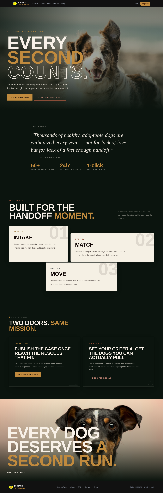
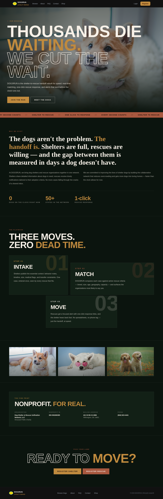

# DOGSRUN

**Every second counts.** A shelter-to-rescue dog matching platform that gets urgent dogs in front of the right rescue partners — before the clock runs out.

Shelters list dogs on intake. DOGSRUN automatically matches them against rescue organizations' criteria and fires instant email alerts. Rescues respond with one click. No spreadsheets, no phone tag — just the handoff, at speed.

**Live:** https://dogsrun.org

## Screenshots





## Tech Stack

| Layer | Tool |
|---|---|
| Framework | Next.js 16 (App Router) |
| UI | React 19, TypeScript, Tailwind CSS 4 |
| Database + Auth | Supabase (PostgreSQL, Row Level Security, Auth, Storage) |
| Email | Resend |
| Rate Limiting | Upstash Redis |
| Monitoring | Sentry (client, server, edge) |
| Hosting | Vercel |
| Testing | Vitest (unit), Playwright (e2e) |

## Getting Started

### Prerequisites

- Node.js 20+
- A Supabase project
- Resend API key (for email alerts)
- Upstash Redis (optional locally — rate limiting degrades gracefully)

### Setup

```bash
# Install dependencies
npm install

# Copy env template and fill in real values
cp .env.example .env.local

# Run the dev server
npm run dev
# → http://localhost:3000
```

See [CONTRIBUTING.md](./CONTRIBUTING.md) for the full development workflow, branching conventions, and code review process.

### Environment Variables

| Variable | Required | Description |
|---|---|---|
| `NEXT_PUBLIC_SUPABASE_URL` | Yes | Supabase project URL |
| `NEXT_PUBLIC_SUPABASE_ANON_KEY` | Yes | Supabase anonymous key |
| `SUPABASE_SERVICE_ROLE_KEY` | Yes | Supabase service role key (server-side only) |
| `RESEND_API_KEY` | Yes | Resend API key for alert emails |
| `UPSTASH_REDIS_REST_URL` | No | Upstash Redis URL (rate limiting) |
| `UPSTASH_REDIS_REST_TOKEN` | No | Upstash Redis token |
| `NEXT_PUBLIC_SENTRY_DSN` | Prod | Sentry DSN |
| `SENTRY_ORG` / `SENTRY_PROJECT` / `SENTRY_AUTH_TOKEN` | Prod | Sentry source map upload |

## Project Structure

```
src/
├── app/
│   ├── (public)/       # Marketing pages: home, about, faq, contact, browse
│   ├── dashboard/      # Shelter + rescue portals (authenticated)
│   ├── admin/          # Admin panel (admins only)
│   ├── api/            # API routes: alerts, matching, auth, admin
│   └── auth/           # Login, register, password reset
├── components/
│   ├── ui/             # Shared UI primitives (buttons, cards, dialogs)
│   └── ...             # Feature components (navbar, dog cards, forms)
├── lib/
│   ├── matching.ts     # Core rescue-matching engine
│   ├── urgency.ts      # Euthanasia countdown + urgency helpers
│   ├── email.ts        # Resend templates
│   ├── ratelimit.ts    # Upstash-backed rate limiting
│   └── supabaseAdmin.ts # Privileged Supabase client
tests/
├── e2e.spec.ts         # Playwright end-to-end suite
└── api-security.spec.ts # API security tests
```

## How It Works

1. **Intake** — Shelters publish the essential context: behavior notes, timeline, size, medical flags, transfer constraints.
2. **Match** — DOGSRUN compares each case against active rescue criteria (breed, size, age, geography, capacity) and surfaces the organizations most likely to say yes.
3. **Move** — Rescues get a focused email alert with one-click response links. The shelter hears back fast.

## Testing

```bash
# Unit tests (matching engine)
npm run test:unit

# E2E tests (requires running dev server + test Supabase)
npm run test

# E2E with UI
npm run test:ui

# Lint
npm run lint

# Type check
npx tsc --noEmit
```

## Continuous Scraping (Phase 0–1 — unmerged, unpushed)

> Status: work in progress in the detached worktree
> `/home/abel/dogsrun-scrape`. **Not merged to `main`, not pushed, not
> deployed.** Full plan: [docs/continuous-scraping-plan.md](./docs/continuous-scraping-plan.md).

DOGSRUN keeps its dog list fresh without hand entry by scraping the
shelters that hold dogs in kennels (Steven's direction: scrape shelters,
not rescues). The pilot source is ACCT Philly via its Shelterluv embed.
New dogs land in an approval queue (`import_queue`) for a human to
approve; nothing is auto-imported and fuzzy duplicates are never
auto-merged.

### What exists in this phase

- `src/lib/scraping/types.ts` — normalized `ScrapedDog` + `ShelterAdapter`
  interface (`listDogs()` / `fetchDog()`).
- `src/lib/scraping/normalize.ts` — age/sex/breed/weight/description
  normalization (unit-tested, incl. Shelterluv `5Y/8M/1W` ages).
- `src/lib/scraping/adapters/acct.ts` — Playwright adapter for ACCT
  Philly. It loads the Shelterluv embed in a real headless browser and
  reads the embed's own available-animals endpoint in-page, with a
  paginated rendered-DOM fallback. Polite delay ≥ 1s between pages, max
  ~50 pages per run. Stops (no retry, never solves CAPTCHAs) on HTTP
  403 / 429 / CAPTCHA / bot challenge, and treats zero dogs as a failed
  run, not an empty shelter.
- `src/lib/scraping/dedup.ts` — exact dedup on `(source, source_id)` plus
  human-only fuzzy candidates (same shelter + name + breed + sex + age
  within 0.5 years).
- `supabase/migrations/20261111_scraping_import_queue.sql` — migration
  file **only** for `import_queue` + `sync_runs` (never run against live
  Supabase in this phase).
- `scripts/scrape-acct.ts` — CLI (see below).

### How to run it (dry-run)

```bash
# Dry run (default): prints what would be imported, imports nothing
npx tsx scripts/scrape-acct.ts

# Full list, still writes NOTHING to Supabase in this phase
npx tsx scripts/scrape-acct.ts --live

# Options: --max-pages N (default 5 dry-run, 50 live),
# --limit N (default 25, 0 = all), --json
npx tsx scripts/scrape-acct.ts --max-pages 5 --limit 10 --json
```

Exit codes: `0` ok, `2` blocked/failed run, `1` unexpected error.

### Still to come (Phase 1+)

Approval-queue UI + API routes (`/admin/import-queue`), PSPCA adapter,
Petfinder API feed (needs a key), Resend digest, 6-hour sync, and the
stale/adopted lifecycle. The euthanasia date is not exposed by the
Shelterluv embed, so urgent-dog timestamps need another source.

## Deployment

Production deploys automatically from `main` via Vercel. Every push to `main` triggers a build; CI runs lint, type check, and unit tests first.

Required Vercel environment variables: all `Required` vars above plus the Sentry set.

## Contributing

See [CONTRIBUTING.md](./CONTRIBUTING.md) for branch naming, commit conventions, and the PR process.

## License

MIT — see [LICENSE](./LICENSE).
